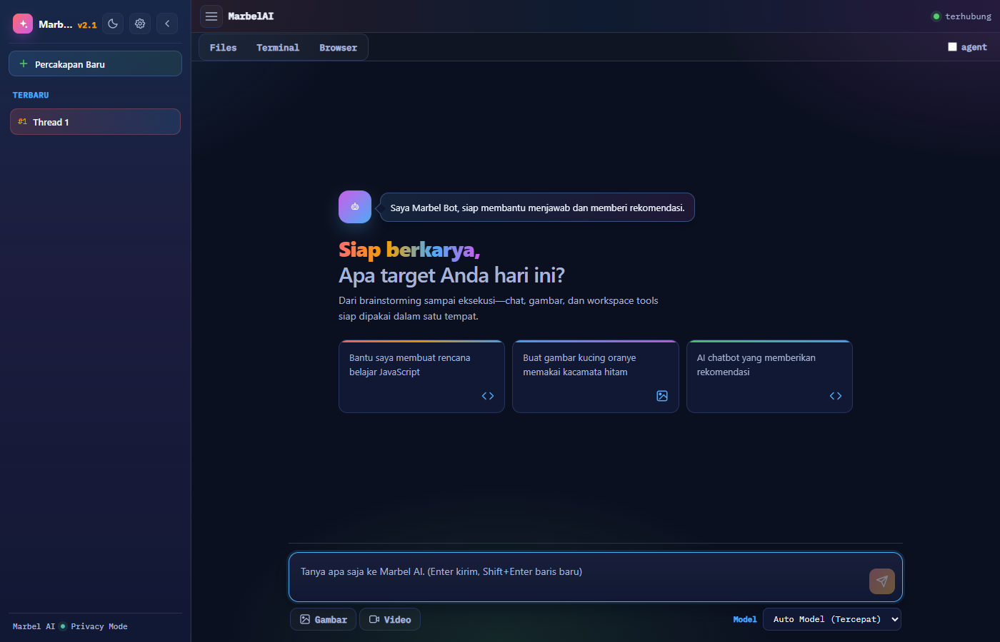
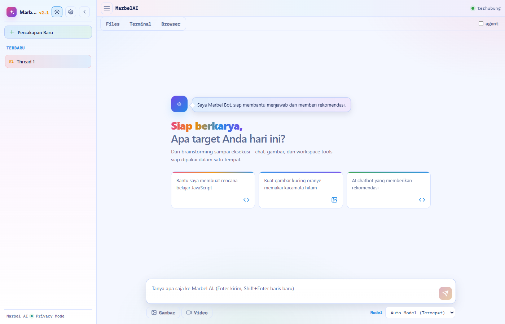
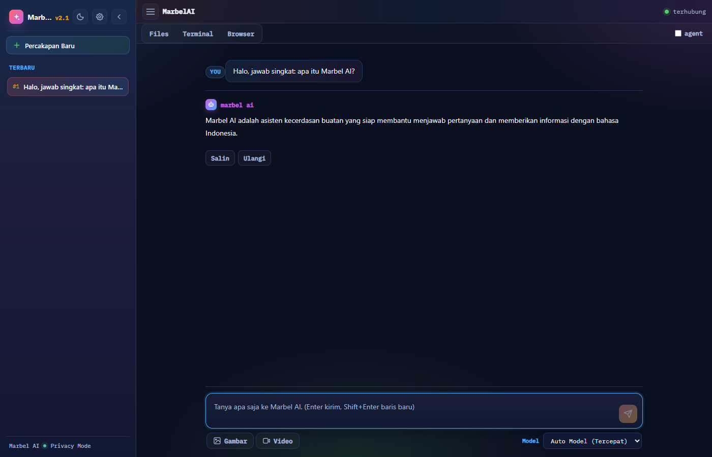
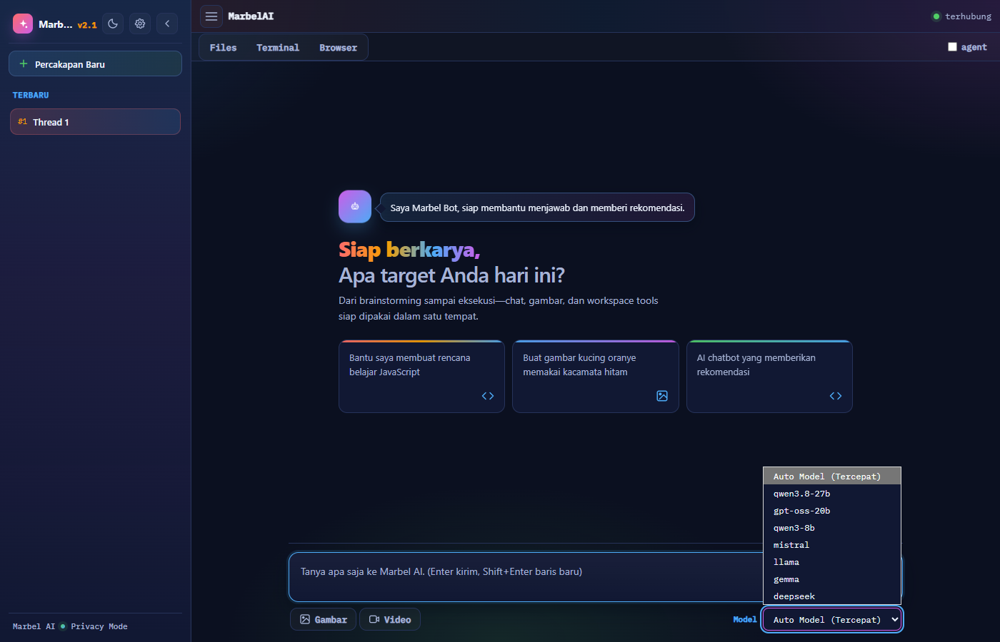
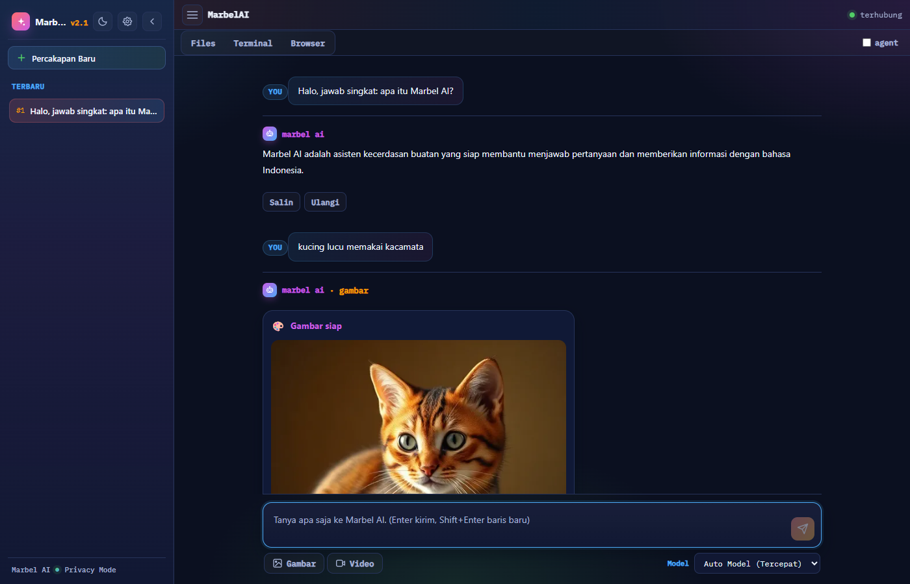
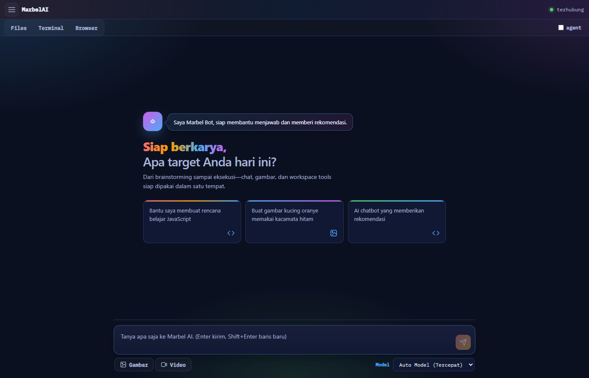
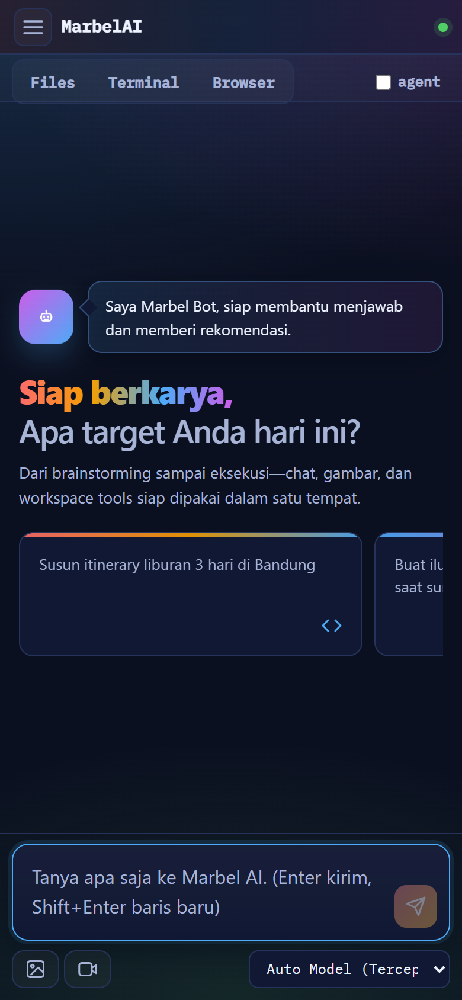
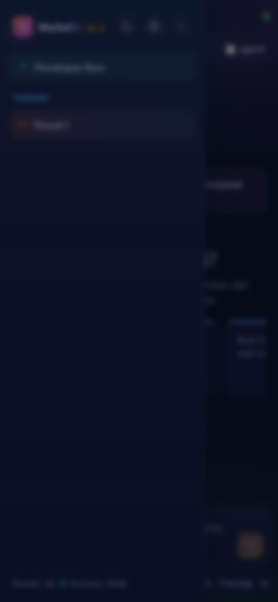
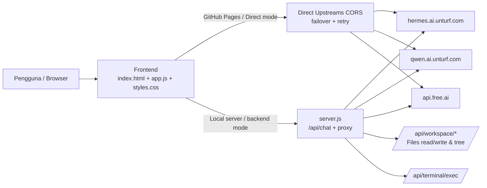
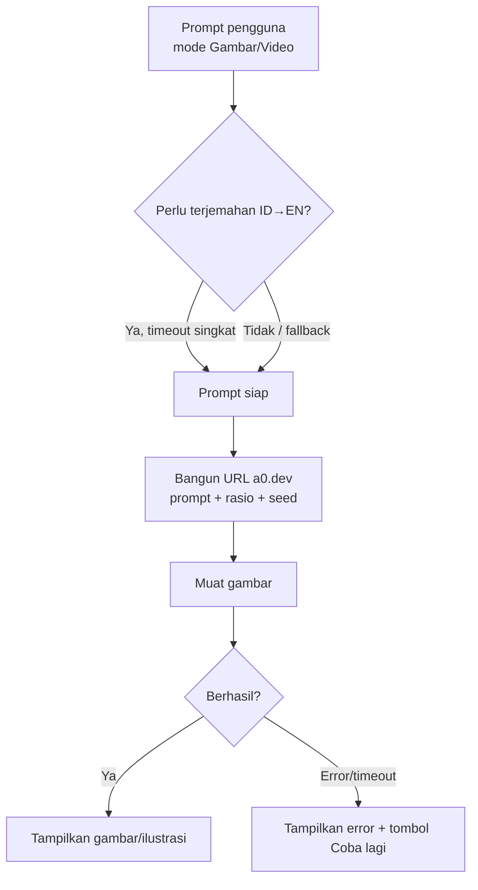

<div align="center">



# Marbel AI v2.1

**Ruang kerja AI gratis - chat, buat gambar, dan ilustrasi video.**  
Ringan, tanpa akun, tanpa API key wajib.

[](https://antono4.github.io/MarbelAIv2.1/)
[](LICENSE)
[](https://nodejs.org)

</div>

---

## Ringkasan

Marbel AI v2.1 adalah aplikasi web AI (frontend statis + backend Node.js opsional) untuk:
- **Chat AI multi-model gratis** (auto/failover, retry penanganan rate-limit)
- **Pembuatan gambar** dan **ilustrasi video** (gambar animasi Ken Burns) via **a0.dev**
- **Workspace tools**: panel **Files**, **Terminal**, **Browser**, **Agent**, dan **Canvas/Preview**
- **Pengaturan lokal** (tema, model default, rasio & model gambar, perilaku Enter, optimasi prompt)

> **Catatan:** model/provider yang digunakan adalah layanan gratis pihak ketiga. Ketersediaan, kecepatan, dan kuota (rate limit/daily limit) dapat berubah sewaktu-waktu. Tangkapan layar bersifat ilustratif dan dapat berbeda dari UI versi terbaru.

---

## Tangkapan Layar

| Layar sambutan (gelap) | Mode terang |
|---|---|
|  |  |

| Chat & aksi pesan | Pilihan model |
|---|---|
|  |  |

| Hasil gambar/media | Sidebar disembunyikan (area chat luas) |
|---|---|
|  |  |

| Tampilan mobile (sambutan) | Tampilan mobile (sidebar) |
|---|---|
|  |  |

---

## Cara Kerja (Visual)

### Arsitektur & alur chat



### Alur pembuatan gambar/ilustrasi



---

## Fitur Utama

### Chat & Model
- **7 model chat gratis**: `qwen3.8-27b`, `gpt-oss-20b`, `qwen3-8b`, `mistral`, `llama`, `gemma`, `deepseek`
- **Auto Model (Tercepat)** / pemilihan model manual
- **Failover antar-upstream** dan **pemetaan model per provider** agar pilihan model tetap bisa menghasilkan respons
- **Retry/backoff untuk rate limit (429)** dan failover yang diperkuat (client & server)
- **UI percakapan**: riwayat thread, sambutan dinamis, avatar/robot helper, salin/ulang jawaban, blok kode, dll.

### Gambar & Ilustrasi Video
- **Mode Gambar**: generate gambar dari teks (prompt Indonesia didukung; ada opsi terjemahan/optimasi prompt)
- **Mode Video**: menghasilkan **ilustrasi animasi (Ken Burns)** dari gambar (bukan text-to-video AI murni)
- **Generator**: `a0.dev` (satu provider)
- **Opsi model gambar** (via **Pengaturan** atau **dropdown Model saat mode Gambar/Video aktif**):
  - `Auto (a0.dev)`
  - `a0.dev`
- **Tombol “Coba lagi”** membuat seed baru (URL baru)

### Workspace & Produktivitas
- **Canvas/Preview**: editor + preview HTML/CSS/JS (iframe `srcdoc`, sandbox)
- **Files panel**: jelajah/baca/tulis file workspace (API server lokal)
- **Terminal panel**: eksekusi perintah di workspace (API server lokal)
- **Browser panel**: navigasi/pratinjau URL (bergantung X-Frame/CSP target)
- **Agent mode/panel** (sesuai kemampuan UI)

### Pengaturan
Tersimpan di `localStorage` (`marbel-settings-v1`): tema, model chat default, rasio gambar, **model gambar/ilustrasi video**, optimasi prompt gambar, dan perilaku Enter.

---

## Menjalankan Secara Lokal

**Prasyarat:** Node.js 18+

```bash
# dari root repo
node server.js

# Windows PowerShell (contoh port & workspace)
$env:PORT='12000'; $env:WORKSPACE_ROOT='C:\path\ke\workspace'; node server.js
```

Buka: **http://localhost:12000**

- `PORT` (default `12000`)
- `WORKSPACE_ROOT` (default: direktori kerja saat server dijalankan) — membatasi akses Files/Terminal

---

## Endpoint API (server.js)

| Endpoint | Metode | Fungsi |
|---|---|---|
| `/` | GET | UI statis |
| `/api/models` | GET | Daftar model chat yang tersedia |
| `/api/chat` | POST | Proxy chat OpenAI-compatible (failover & retry 429) |
| `/api/workspace/info` | GET | Info workspace root/path aktif |
| `/api/workspace/tree?path=.` | GET | Daftar isi direktori workspace |
| `/api/workspace/file?path=...` | GET | Baca file workspace |
| `/api/workspace/file` | POST | Tulis/simpan file workspace |
| `/api/terminal/exec` | POST | Eksekusi perintah di workspace |

---

## Model Chat & Upstream

- **Model UI/chat**: `qwen3.8-27b`, `gpt-oss-20b`, `qwen3-8b`, `mistral`, `llama`, `gemma`, `deepseek`
- **Upstream default (failover berurutan)**: `hermes.ai.unturf.com`, `qwen.ai.unturf.com`, `api.free.ai`
- Model UI dipetakan ke model yang dikenali tiap upstream (termasuk fallback aman)

Env opsional: `PORT`, `WORKSPACE_ROOT`, `UPSTREAM`, `UPSTREAM_PREFIX`, `DEFAULT_MODEL`, `MODELS_LIST`, `API_KEY`, `ALLOW_ORIGIN`, `USE_SSE`, `FORCE_NO_STREAM`, `MODELS_TTL`, `DEBUG_LOG`.

---

## Catatan Gambar & Video

- Generator gambar memakai **a0.dev** (`api.a0.dev/assets/image`).
- **Mode Video** saat ini = ilustrasi animasi dari gambar (bukan text-to-video AI). Integrasi video AI asli umumnya memerlukan API key/provider berbayar atau GPU.

---

## Pemecahan Masalah

| Gejala | Penyebab umum | Solusi |
|---|---|---|
| `Backend: Failed to fetch` | Server lokal tidak berjalan / salah origin | Jalankan `node server.js`, buka `http://localhost:12000`, refresh |
| `429` / `FREE_LIMIT` / `Daily limit reached` | Rate limit/kuota provider gratis habis | Tunggu & coba lagi, ganti model chat (Auto/model lain), gunakan server lokal; retry/failover aktif tapi kuota harian tidak bisa dihilangkan |
| Gambar/ilustrasi gagal atau lambat | Provider gambar sibuk/limit/berubah | Klik **Coba lagi**, pastikan koneksi stabil, kurangi/ubah prompt; generator saat ini hanya `a0.dev` |
| Preview HTML di Canvas blank | Masalah render iframe/sandbox/cache | Hard refresh (`Ctrl+F5`), gunakan Canvas Preview |
| Tombol kirim tidak aktif | Input kosong / sedang memproses / cache JS lama | Ketik pesan, tunggu selesai, hard refresh; cek Console bila perlu |
| Fitur Files/Terminal tidak jalan | Dibuka tanpa backend server lokal | Akses via `http://localhost:12000` (mode backend) |

---

## Deployment

- **GitHub Pages**: UI statis dapat berjalan dalam mode direct (CORS) untuk chat/gambar sesuai ketersediaan provider; fitur workspace/terminal membutuhkan backend.
- **Hosting Node (Render/Railway/VPS/dll.)**: jalankan `server.js` (atur `PORT`, `UPSTREAM`, `WORKSPACE_ROOT`, dll. sesuai kebutuhan).

> File deployment tambahan (`Dockerfile`, `render.yaml`, `railway.json`, `build-apk.sh`, `android/`) tidak disertakan di salinan ini.

---

## Lisensi

[MIT](LICENSE) — Copyright (c) 2026 Antono4
